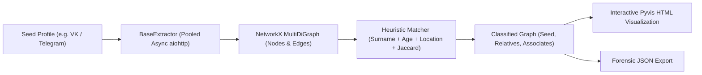

<div align="center">


# OmniTrace

**A minimalist, open-source OSINT intelligence platform, social graph mapper, and forensic dashboard.**  
*High-precision multi-source reconnaissance without third-party tracking, API lock-in, or false positives.*

[](LICENSE)
[](https://python.org)
[](https://fastapi.tiangolo.com)
[](https://react.dev)
[](https://networkx.org)
[](Dockerfile)
[](#-opsec--privacy-first)

[English](#-english) • [Русский](#-русский) • [Quickstart](#-quickstart) • [Social Graph Engine](#-social-graph-mapping-engine) • [Verified Sources](#-verified-sources)

</div>

---

## 📖 English

### Overview

**OmniTrace** is an open-source, privacy-first intelligence platform engineered as an autonomous, self-hosted replacement for legacy browser OSINT tools like *OSINT.Rocks*.

Unlike centralized SaaS aggregators that store search logs and suffer from catastrophic false positives, OmniTrace runs entirely on your local machine or private server. It features an ultra-clean **dark-white minimalist aesthetic**, **real-time Server-Sent Events (SSE) streaming**, an automated **Zero-False-Positive verification engine**, and a high-performance **Social Graph Mapping system** powered by NetworkX and Pyvis.

---

### ⚡ Key Highlights

1. **🎯 100% Precision (Zero False Positives):** Every probe uses verified API endpoints, signature validations, and WAF challenge suppression. If an account does not exist, OmniTrace will never claim it does.
2. **🕸️ Social Graph Mapping & Heuristic Inference:** Built-in graph theory engine (`networkx`) that extracts friend networks, detects generational family trees (siblings, parents/children), computes Jaccard neighborhood density, and generates interactive dark-mode HTML graphs (`pyvis`).
3. **⚡ Universal Smart Input:** Paste a username (`torvalds`), email (`contact@domain.com`), domain (`python.org`), IP (`1.1.1.1`), phone (`+14155552671`), or hash — OmniTrace auto-detects the entity and launches relevant probes.
4. **📡 Real-Time SSE Streaming:** Probe findings stream to your browser as they resolve asynchronously, with response latencies, HTTP codes, and metadata.
5. **🛡️ 100% OPSEC & Anonymity:** Integrated support for upstream SOCKS5, HTTP, and Tor routing (`socks5://127.0.0.1:9050`). Zero third-party telemetry, zero external logging.
6. **📁 Forensic Case Vault & Export:** Organize findings into case folders, attach investigation notes, and export printable **HTML Dossiers**, machine-readable **JSON dumps with SHA-256 integrity hashes**, or **CSV tables**.

---

### 🕸️ Social Graph Mapping Engine

The social graph subsystem ([`backend/app/modules/social_graph/`](backend/app/modules/social_graph/)) provides automated link analysis:



- **Core Data Structure:** `networkx.MultiDiGraph` representing entities (`ProfileNode`) and multiplex connections (`RelationshipEdge`).
- **Resilient Async Extractor:** `BaseExtractor` with `aiohttp` connection pooling, adaptive rate-limiting delays, and exponential backoff with jitter on HTTP `429/5xx`.
- **Heuristic Correlation Algorithm:**
  - **Surnames:** Exact and Cyrillic/Latin gender-inflected matching (`Иванов` $\leftrightarrow$ `Иванова`).
  - **Geography:** Hometown identity and regional co-location similarity.
  - **Generational Age:** Sibling delta ($\le 10$ yrs) and Parent-Child delta ($18 - 45$ yrs).
  - **Topological Density:** Jaccard similarity of mutual friends $J(A, B) = \frac{|\Gamma(A) \cap \Gamma(B)|}{|\Gamma(A) \cup \Gamma(B)|}$.
- **Interactive Visualizer:** Generates standalone interactive HTML graphs styled in OmniTrace's dark-white palette using Pyvis (`forceAtlas2Based` physics).

---

### 🚀 Quickstart

#### Option 1: 1-Command Local Launch (Recommended) ⚡
The React frontend is already pre-built in `frontend/dist`. FastAPI serves both the API and the web interface on a single port:

```bash
cd backend
source venv/bin/activate
python run.py
```
👉 Open your browser at **[http://localhost:8000](http://localhost:8000)**  
👉 Interactive API documentation (Swagger): **[http://localhost:8000/docs](http://localhost:8000/docs)**

---

#### Option 2: Live Development Mode (Hot-Reload) 🛠️

**Terminal 1 (Backend):**
```bash
cd backend
source venv/bin/activate
python run.py
```

**Terminal 2 (Frontend):**
```bash
cd frontend
npm run dev
```
👉 Open **[http://localhost:5173](http://localhost:5173)** *(automatically proxies API queries to port 8000)*.

---

#### Option 3: Docker Compose 🐳
```bash
docker compose up -d
```
👉 Open **[http://localhost:8000](http://localhost:8000)**.

---

### 🎯 Verified Sources

OmniTrace avoids naive scrapers that falsely report HTTP 200 on SPA error pages. Supported verified services include:

| Category | Platforms & Probes |
| :--- | :--- |
| **Development & Code** | GitHub (API), GitLab, Bitbucket (API), DockerHub, Dev.to (API), HackerNews (Firebase), Codeforces (API), Crates.io (API), npm (API), Pastebin, WakaTime |
| **Social & Communities** | Bluesky (ATProto API), Mastodon Social (API), Telegram (Signature), Pinterest (oEmbed), Steam (Persona Signature), Duolingo (API), Keybase (JSON API), Linktree, YouTube |
| **Music & Media** | SoundCloud, Vimeo, Flickr, Dribbble, Goodreads, Habr, Gravatar Profile |
| **Network & Infrastructure** | Authoritative DNS (A, AAAA, MX, NS, TXT, SOA), RDAP / WHOIS, crt.sh Subdomains, IP Geolocation & ASN, HTTP Security Headers |
| **Telephony & Leaks** | Google libphonenumber, WhatsApp & Telegram verification links, HaveIBeenPwned k-Anonymity (SHA-1) |

---

## 🇷🇺 Русский

### О проекте

**OmniTrace** — это минималистичная, полностью открытая платформа для разведки по открытым источникам (OSINT), картирования социальных графов и интерактивных расследований в браузере.

В отличие от устаревших сервисов вроде *OSINT.Rocks*, в OmniTrace:
1. **0% ложных срабатываний:** Каждый источник проверяется через официальные API или жесткие контентные сигнатуры — никаких ложных «зеленых» карточек на несуществующие профили.
2. **Модуль социального графа (`social_graph`):** Построение графа связей через NetworkX, автоматическое выявление родственников и близких связей по эвристикам (одинаковые фамилии с учетом склонений, разница в возрасте, общий город, взаимные друзья) и экспорт интерактивного 3D-графа через Pyvis.
3. **100% OPSEC и приватность:** Ваши цели никогда не передаются на сторонние сервера. Поддержка работы через Tor и SOCKS5 прямо в интерфейсе.
4. **Строгий минималистичный дизайн:** Монохромная темно-белая палитра (*Linear / Vercel style*), без лишнего шума и рекламы.

---

### 🚀 Быстрый запуск

#### Самый простой способ (1 команда):
```bash
cd backend
source venv/bin/activate
python run.py
```
Откройте в браузере: **[http://localhost:8000](http://localhost:8000)**.

___

### 🔒 Лицензия
Распространяется под свободной лицензией [MIT](LICENSE).
Присоединяйтесь к разработке и ставьте ⭐ на GitHub!
