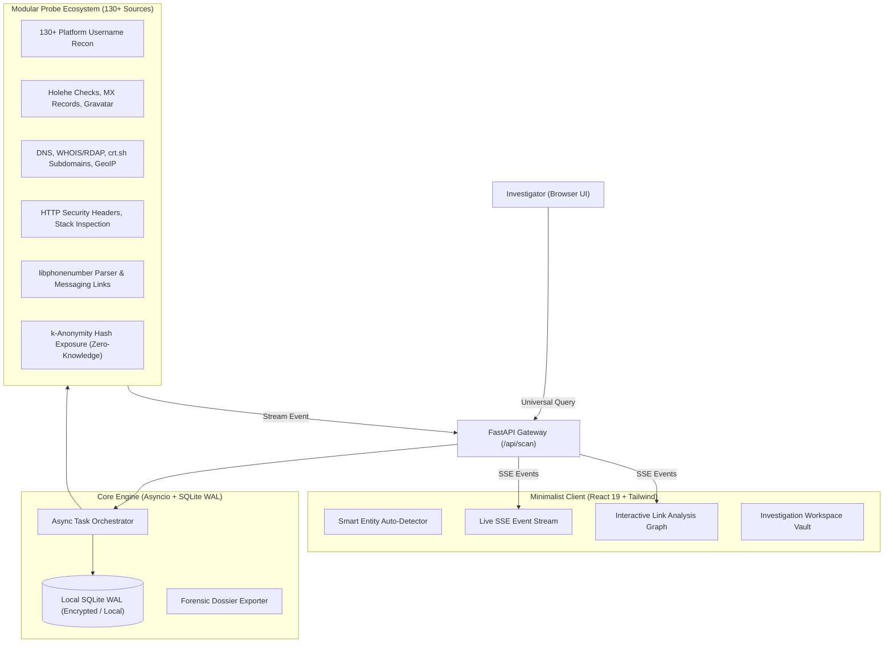

<div align="center">


# OmniTrace

**A minimalist, open-source OSINT reconnaissance platform and interactive forensic dashboard.**  
*High-velocity multi-source intelligence without third-party tracking, API lock-in, or terminal complexity.*

[](LICENSE)
[](https://python.org)
[](https://fastapi.tiangolo.com)
[](https://react.dev)
[](Dockerfile)
[](#-opsec--privacy-first)

[English](#-english) • [Русский](#-русский) • [Supported Sources (130+)](#-supported-sources-matrix) • [Quickstart](#-quickstart)

</div>

---

## 📖 English

### The Problem OmniTrace Solves

Centralized web OSINT tools (such as the former *OSINT.Rocks*) offered browser-based simplicity, but introduced critical compromises:
1. **Severe OPSEC Risks:** Target queries, investigator IP addresses, and search timestamps are stored on third-party servers.
2. **SaaS Fragility:** When third-party platforms go down or take breaks, active investigations are paralyzed.
3. **Fragmented Workflows:** Investigators had to navigate between separate tools for usernames, emails, DNS, and IP lookups.
4. **No Visual Correlation:** Results were limited to static lists with no relationship graphs or case tracking.

**OmniTrace solves this completely.** It is a **100% self-hostable, zero-telemetry, unified intelligence dashboard** with a minimalist dark-white aesthetic, real-time Server-Sent Events (SSE) streaming, interactive relationship graph visualization, and an expanding suite of **130+ reconnaissance sources**.

---

### ⚡ Core Capabilities

- **🎯 Universal Smart Input:** Paste a username (`torvalds`), email (`contact@domain.com`), domain (`python.org`), IP (`1.1.1.1`), phone (`+14155552671`), or hash. OmniTrace's heuristic engine auto-detects the entity and configures appropriate probes.
- **📡 Real-Time SSE Streaming:** Probe findings appear on your screen as they resolve asynchronously, complete with response latencies, HTTP response codes, and deep metadata.
- **🕸️ Interactive Link Analysis Graph:** An integrated HTML5 canvas relationship visualizer maps correlations between target nodes, accounts, mail servers, IP allocations, and domains.
- **🛡️ OPSEC & Tor Proxy Routing:** Native support for upstream HTTP, SOCKS5, and Tor proxy routing. Zero analytics, zero phone-home pings, zero telemetry.
- **📁 Case & Workspace Management:** Group scans into isolated cases, record timestamped investigation notes, and preserve forensic audit logs.
- **📑 Multi-Format Dossier Export:** Generate printable standalone **HTML Dossiers**, machine-readable **JSON payloads** with **SHA-256 cryptographic fingerprints**, or **CSV spreadsheets**.

---

### 🏛️ Architecture Flow



---

### 🌐 Supported Sources Matrix

OmniTrace scans across **130+ platforms and network registries** out of the box with zero external API key requirements:

| Category | Primary Integrated Services |
| :--- | :--- |
| **Development & Code** | GitHub, GitLab, Bitbucket, DockerHub, Dev.to, HackerNews, Kaggle, LeetCode, HackerRank, Codeforces, Codecademy, Replit, WakaTime, Pastebin, PyPI, npm, Packagist, Crates.io, SourceForge, Codeberg, Hashnode, Habr, ProductHunt |
| **Social & Microblogs** | Twitter/X, Reddit, Bluesky, Threads, Instagram, TikTok, Pinterest, Tumblr, Mastodon Social, VK (Vkontakte), OK.ru, Keybase, Disqus |
| **Identity & Bio Links** | Linktree, Carrd, About.me, Bio.link, Bento.me, Gravatar Profile |
| **Video & Streaming** | YouTube, Twitch, Kick, Vimeo, Dailymotion, Rumble, Odysee |
| **Music & Audio** | Spotify, SoundCloud, Bandcamp, Last.fm, Mixcloud, Audiomack, Genius, Discogs |
| **Gaming & Esports** | Steam, Chess.com, Lichess, Roblox, NameMC (Minecraft), osu!, Speedrun.com, Itch.io, GameJolt |
| **Creative & Design** | Dribbble, Behance, ArtStation, DeviantArt, Flickr, 500px, Giphy |
| **Publishing & Funding** | Medium, Substack, Patreon, BuyMeACoffee, Ko-fi |
| **Specialized & Tech** | Duolingo, Letterboxd, MyAnimeList, Trakt, Goodreads, Strava, Instructables, Thingiverse, Printables, Hackster.io |
| **Network & Infrastructure** | Authoritative DNS (A, AAAA, MX, NS, TXT, SOA), RDAP / WHOIS, crt.sh Certificate Transparency, IP-API Geolocation & ASN, HTTP Headers & Server Stack |
| **Telephony & Leaks** | Google libphonenumber, WhatsApp & Telegram verification links, HaveIBeenPwned k-Anonymity (SHA-1) |

---

### ⚡ Quickstart

#### 1. Docker Compose (Recommended)
```bash
git clone https://github.com/kraim0v/OmniTrace.git
cd OmniTrace

docker compose up -d
```
Visit **`http://localhost:8000`** in your browser.

#### 2. Manual Development Setup
```bash
# Backend Setup
cd backend
python3 -m venv venv
source venv/bin/activate
pip install -r requirements.txt
python run.py

# Frontend Setup (in separate terminal)
cd frontend
npm install
npm run dev
```

---

## 🇷🇺 Русский

### О проекте
**OmniTrace** — это минималистичная, полностью открытая платформа для разведки по открытым источникам (OSINT) и интерактивный дашборд для расследований в браузере.

Проект спроектирован как бескомпромиссная замена сервису *OSINT.Rocks*, Spiderfoot и консольным утилитам, объединяя более **130+ источников данных** в строгом монохромном темном интерфейсе.

### 🌟 Ключевые преимущества

- **🛡️ Полная автономность и OPSEC:** Ни один байт данных или поисковый запрос не передается на сторонние сервера. Вы можете запустить OmniTrace на своем ноутбуке или VPS и маршрутизировать трафик через **Tor** или приватные SOCKS5-прокси.
- **⚡ Универсальный Smart Search:** Автоматическое определение сущности: введите никнейм (`torvalds`), почту (`test@domain.com`), домен (`python.org`), IP (`8.8.8.8`), телефон (`+14155552671`) или хеш пароля.
- **📡 Мгновенный стриминг (SSE):** Найденные аккаунты и данные отображаются в ту же секунду, когда сервер получает ответ, без ожидания завершения всех 130+ проверок.
- **🕸️ Граф связей (Link Analysis):** Интерактивная визуализация взаимосвязей между целевым объектом, найденными профилями, почтовыми серверами, поддоменами и IP-адресами.
- **📁 Ведение дел (Cases):** Создавайте кейсы для расследований, прикрепляйте заметки и отслеживайте цифровой след подозреваемых или объектов анализа.
- **📑 Экспорт досье:** Выгрузка печатного автономного HTML-отчета, JSON-дампа с контрольной суммой SHA-256 (для соблюдения правил фиксации доказательств) или таблицы CSV.

---

### 🔒 Безопасность и правовая оговорка (Disclaimer)

OmniTrace предназначен исключительно для специалистов по информационной безопасности, расследователей, журналистов и системных администраторов в целях защиты цифрового периметра, OSINT-анализа и аудита собственных данных. Инструмент использует исключительно публичные методы и пассивные протоколы открытых источников.

---

### 📄 Лицензия
Проект распространяется под открытой лицензией [MIT](LICENSE).
Сделано с акцентом на приватность и чистый код. Поставьте ⭐ репозиторию!
